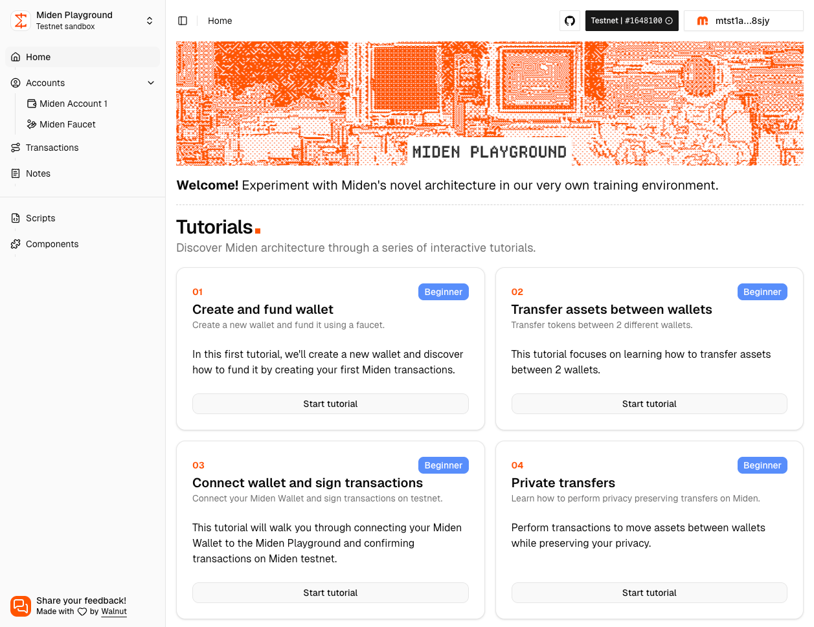

<p align="center">
  <h1 align="center">Miden Playground</h1>
</p>
<p align="center">
  <strong><i>Learn, Build and Deploy Miden smart contracts from a browser IDE.</i></strong>
  
</p>

This is the source code that runs the [Miden Playground](https://playground.miden.xyz) web application. Below you will find the docs on how to contribute to the project and get it up and running locally for further development.

Miden Playground is brought to you by [Walnut](https://www.walnut.dev).

## ⚙️ Installation

The app requires the following dependencies:

- [NodeJS](https://nodejs.org/) >= 26
- [pnpm](https://pnpm.io/) >= 11

## 👩‍💻 Local Development

For contributing to the project, you can quickly get the application running by following these steps:

Clone this repository:

```sh
git clone https://github.com/walnuthq/miden-playground.git
```

Install dependencies:

```sh
pnpm install
```

Start up the app and see it running at http://localhost:3000

```sh
pnpm dev
```

### Environment variables

Every variable is optional locally: unset ones fall back to local defaults (localhost services, the docker-compose database), or disable the feature (Para, analytics). Each app documents its variables in a committed `.env.example`, to copy to `.env.local` for local overrides:

|                   | `apps/web` (Vite SPA + Worker)             | `apps/api` (Hono on Workers)                          | `apps/status-page` (Vite, probe scripts)                     |
| ----------------- | ------------------------------------------ | ----------------------------------------------------- | ------------------------------------------------------------ |
| Local overrides   | `.env.local`                               | `.env.local`                                          | `.env.local`                                                 |
| Local defaults    | `lib/constants.ts`                         | `vars` in `wrangler.jsonc`, `DATABASE_URL` in `.env`  | `scripts/probe.ts`, `vite.config.ts`                         |
| Production values | `.env.production`, inlined by `vite build` | `env.production` in `wrangler.jsonc`                  | `env` in `deploy-status-page.yml`, Slack webhook as a secret |
| Types             | `vite-env.d.ts`                            | `cloudflare-env.d.ts`, generated by `pnpm cf-typegen` | `process-env.d.ts`                                           |
| Turbo             | `env` of `miden-playground-web#build`      | `passThroughEnv` of `miden-playground-api#build`      | `env` of `status-page#build` and `status-page#notify`        |

Keep an app's files in sync when adding a variable. `apps/web/.dev.vars` only holds the Worker's `SIMPLE_ANALYTICS_HOSTNAME` and `ANALYTICS_HOSTNAME`, for `wrangler dev` (`pnpm preview`); the app's `VITE_*` variables come from the `.env` files (local `.env*.local` files with the old `NEXT_PUBLIC_*` names are silently ignored, so the app falls back to its defaults). Don't add one to `apps/api`: wrangler ignores `.env` files when a `.dev.vars` exists.

```sh
cp apps/web/.env.example apps/web/.env.local
cp apps/api/.env.example apps/api/.env.local
cp apps/status-page/.env.example apps/status-page/.env.local
```

Start PostgreSQL and setup database. `DATABASE_URL` (committed default in `apps/api/.env`, override in `.env.local`) is used both by drizzle-kit and by `wrangler dev`, which points the API's [Hyperdrive](https://developers.cloudflare.com/hyperdrive/) binding at it. `db:migrate` applies the migrations in `apps/api/drizzle` (see [Database migrations](#database-migrations)):

```sh
docker compose -f apps/api/docker-compose.yml up -d
pnpm --filter miden-playground-api db:migrate
```

Build Rust helpers:

```sh
pnpm --filter miden-playground-api build:rust
```

Install Miden Rust compiler using this guide: https://0xmiden.github.io/compiler/usage/cargo-miden.html

### Local node setup

When running the app locally, you can use the playground against a local node by selecting the "New Local sandbox" option, learn how to launch [miden-node](https://github.com/0xMiden/miden-node) following this guide: https://docs.miden.xyz/builder/develop/tutorials/miden_node_setup/

## 🚀 Deploying

Both apps run on [Cloudflare Workers](https://workers.cloudflare.com/) and are deployed by GitHub Actions when a PR is merged to `main`, each only when its sources change:

- [`deploy-web-cloudflare.yml`](.github/workflows/deploy-web-cloudflare.yml) builds `apps/web` with Vite and deploys the `miden-playground` Worker, which serves the build as static assets (with SPA fallback) and proxies Simple Analytics. Its build variables are committed in `apps/web/.env.production`.
- [`deploy-api-cloudflare.yml`](.github/workflows/deploy-api-cloudflare.yml) applies the pending database migrations, then deploys the `miden-playground-api` Worker (`wrangler deploy --env production`). Its variables, Hyperdrive binding and custom domain are in `env.production` in `apps/api/wrangler.jsonc`.

Both workflows can also be run manually (_Run workflow_ in the Actions tab), and need the `CLOUDFLARE_API_TOKEN` and `CLOUDFLARE_ACCOUNT_ID` repository secrets. The api workflow also needs `DATABASE_URL`.

### Database migrations

The api workflow applies pending [Drizzle](https://orm.drizzle.team/) migrations (`apps/api/drizzle`) to the production database, then deploys the Worker. It connects with the `DATABASE_URL` repository secret: a direct Postgres connection string to the database Hyperdrive fronts, reachable from GitHub's runners. A migration that fails stops the deploy.

Until the deploy finishes, and for longer if it fails, the Worker still running is the previous version, on the new schema. So each migration must keep working with the code already deployed. Adding a table, or a column that is nullable or has a default, is safe. Renaming or dropping something takes two releases: first ship code that no longer uses it, then the migration that removes it (as `packages.rust` was dropped).

After editing `apps/api/db/schema.ts`, generate a migration with `pnpm --filter miden-playground-api db:generate --name <what_it_does>`, check it with `db:migrate` on your local database, and commit it with the schema change. Don't change production with `db:push`: it bypasses the migration journal the workflow relies on. Use `db:push` only on throwaway local databases.

The first migration, `*_baseline`, is the schema production had when migrations were introduced (production had been set up with `db:push`). It was recorded as applied there by hand, without running it. On a local database created with `db:push` before then, `db:migrate` fails (`type "package_status" already exists`): reset it with `docker compose -f apps/api/docker-compose.yml down -v`, then `up -d` and `db:migrate`.

To try a build of `apps/web` before merging, upload it as a preview version with the `qa` alias and test it on `https://qa-miden-playground.walnuthq.workers.dev`:

```sh
pnpm --filter miden-playground-web upload --preview-alias qa
```

Use that alias, not a version's own preview URL: Para's production key rejects any other origin (403 `origin not authorized`, and the app stays blank because Para's provider never initializes). The production API and registry allow that alias in CORS too, so every tutorial and example runs on it. For the same reason, a production build served locally (`pnpm preview`, port 8787) is blank. To test a build locally, build it in development mode, so that it takes your BETA Para key (`VITE_PARA_API_KEY` in `.env.local`, see `.env.example`) instead of the production one in `.env.production`, and serve it on port 3000: `vite build --mode development && wrangler dev --port 3000` in `apps/web`. Para's test accounts only exist in BETA, so the e2e Para tests skip themselves on the `qa` alias.

## 📈 Status

The health of the deployed services is published at [walnuthq.github.io/miden-playground](https://walnuthq.github.io/miden-playground/), rebuilt every 30 minutes by GitHub Actions. See [`apps/status-page`](apps/status-page/README.md) for what it checks and how to configure it.

## 🤗 Contributing

Miden Playground is built and maintained by a small team, so we would definitely love your help to fix bugs, add new features and improvements. Head on to the [issues tab](https://github.com/walnuthq/miden-playground/issues) to find a list of open contributions.

Before you submit a pull request, please make sure there isn't an existing [GitHub issue](https://github.com/walnuthq/miden-playground/issues). If there isn't, create one first to discuss the best way to approach it and also get some feedback from the team.

Once you are about to submit a pull request, prefix the name with either `chore:` (small improvements and regular maintenance), `fix:` (bugs and hot fixes), or `feat:` (new features) to help us quickly look up the type of the issue from the Git history.

### Coding conventions

The project is already pre-configured with [Biome](biome.json) for linting and formatting, and [TypeScript](tsconfig.json). Here are some useful commands you can run to ensure your changes follow the project's coding conventions:

Check for any linting or formatting issues:

```sh
pnpm lint
```

Format the code and apply safe fixes:

```sh
pnpm format
```

Check for any TypeScript issues:

```sh
pnpm typecheck
```

### Tests

Unit tests (`node:test`, plain node) cover the web app's pure helpers, such as the compile diagnostics parser, the console's output cleanup, the MASM vocabulary and the manifest patch. `masm:check` reports when the MASM vocabulary is out of date with the assembler:

```sh
pnpm --filter miden-playground-web test
pnpm --filter miden-playground-web masm:check
```

The end-to-end tests (Playwright) run the tutorials, the examples and the script editor against a live Playground on testnet, with the app on port 3000 and the API on port 3001. See [`apps/web/e2e`](apps/web/e2e/README.md).

## License

[MIT](LICENSE)
