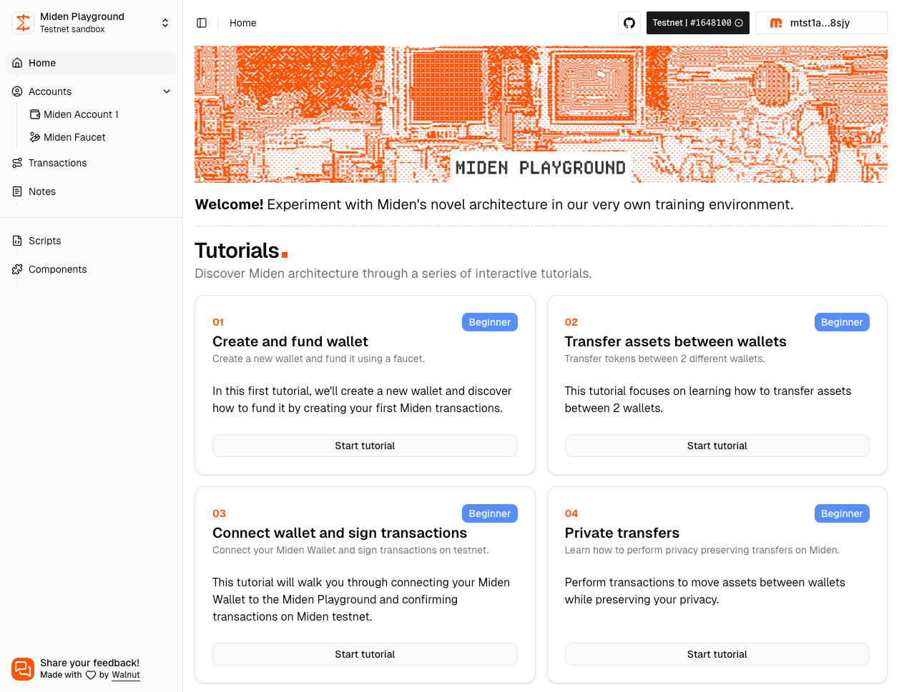

<p align="center">
  <h1 align="center">Miden Playground</h1>
</p>
<p align="center">
  <strong><i>Learn, Build and Deploy Miden smart contracts from a browser IDE.</i></strong>
  
</p>

This is the source code that runs the [Miden Playground](https://playground.miden.xyz) web application. Below you will find the docs on how to contribute to the project and get it up and running locally for further development.

Miden Playground is brought to you by [Walnut](https://www.walnut.dev).

## ⚙️ Installation

The app requires the following dependencies:

- [NodeJS](https://nodejs.org/) >= 24
- [pnpm](https://pnpm.io/) >= 11

## 👩‍💻 Local Development

For contributing to the project, you can quickly get the application running by following these steps:

Clone this repository:

```sh
git clone https://github.com/walnuthq/miden-playground.git
```

Install dependencies:

```sh
pnpm install
```

Start up the app and see it running at http://localhost:3000

```sh
pnpm dev
```

### Environment variables

Every variable is optional locally: unset ones fall back to local defaults (localhost services, the docker-compose database), or disable the feature (Para, analytics). Each app documents its variables in a committed `.env.example`, to copy to `.env.local` for local overrides:

| | `apps/web` (Next.js on OpenNext) | `apps/api` (Hono on Workers) | `apps/status-page` (Vite, probe scripts) |
| --- | --- | --- | --- |
| Local overrides | `.env.local` | `.env.local` | `.env.local` |
| Local defaults | `lib/constants.ts` | `vars` in `wrangler.jsonc` | `scripts/probe.ts`, `vite.config.ts` |
| Production values | `.env.production`, inlined by `next build` | `env.production` in `wrangler.jsonc` | `env` in `deploy-status-page.yml`, Slack webhook as a secret |
| Types | `process-env.d.ts` | `cloudflare-env.d.ts`, generated by `pnpm cf-typegen` | `process-env.d.ts` |
| Turbo | `env` of `miden-playground-web#build` | `passThroughEnv` of `miden-playground-api#build` | `env` of `status-page#build` and `status-page#notify` |

Keep an app's files in sync when adding a variable. `apps/web/.dev.vars` only sets `NEXTJS_ENV` for OpenNext. Don't add one to `apps/api`: wrangler ignores `.env` files when a `.dev.vars` exists.

```sh
cp apps/web/.env.example apps/web/.env.local
cp apps/api/.env.example apps/api/.env.local
cp apps/status-page/.env.example apps/status-page/.env.local
```

Start PostgreSQL and setup database (`apps/api` reaches it through [Hyperdrive](https://developers.cloudflare.com/hyperdrive/), which `wrangler dev` points at this container):

```sh
docker compose -f apps/api/docker-compose.yml up -d
pnpm --filter miden-playground-api db:push
```

Build Rust helpers:

```sh
pnpm --filter miden-playground-api build:rust
```

Install Miden Rust compiler using this guide: https://0xmiden.github.io/compiler/usage/cargo-miden.html

### Local node setup

When running the app locally, you can use the playground against a local node by selecting the "New Local sandbox" option, learn how to launch [miden-node](https://github.com/0xMiden/miden-node) following this guide: https://docs.miden.xyz/builder/develop/tutorials/miden_node_setup/

## 🚀 Deploying

Both apps run on [Cloudflare Workers](https://workers.cloudflare.com/) and are deployed by GitHub Actions when a PR is merged to `main`, each only when its sources change:

- [`deploy-web-cloudflare.yml`](.github/workflows/deploy-web-cloudflare.yml) builds `apps/web` with OpenNext and deploys the `miden-playground` Worker. Its build variables are committed in `apps/web/.env.production`.
- [`deploy-api-cloudflare.yml`](.github/workflows/deploy-api-cloudflare.yml) deploys the `miden-playground-api` Worker (`wrangler deploy --env production`). Its variables, Hyperdrive binding and custom domain are in `env.production` in `apps/api/wrangler.jsonc`.

Both workflows can also be run manually (_Run workflow_ in the Actions tab), and need the `CLOUDFLARE_API_TOKEN` and `CLOUDFLARE_ACCOUNT_ID` repository secrets.

## 📈 Status

The health of the deployed services is published at [walnuthq.github.io/miden-playground](https://walnuthq.github.io/miden-playground/), rebuilt every 30 minutes by GitHub Actions. See [`apps/status-page`](apps/status-page/README.md) for what it checks and how to configure it.

## 🤗 Contributing

Miden Playground is built and maintained by a small team, so we would definitely love your help to fix bugs, add new features and improvements. Head on to the [issues tab](https://github.com/walnuthq/miden-playground/issues) to find a list of open contributions.

Before you submit a pull request, please make sure there isn't an existing [GitHub issue](https://github.com/walnuthq/miden-playground/issues). If there isn't, create one first to discuss the best way to approach it and also get some feedback from the team.

Once you are about to submit a pull request, prefix the name with either `chore:` (small improvements and regular maintenance), `fix:` (bugs and hot fixes), or `feat:` (new features) to help us quickly look up the type of the issue from the Git history.

### Coding conventions

The project is already pre-configured with [Biome](biome.json) for linting and formatting, and [TypeScript](tsconfig.json). Here are some useful commands you can run to ensure your changes follow the project's coding conventions:

Check for any linting or formatting issues:

```sh
pnpm lint
```

Format the code and apply safe fixes:

```sh
pnpm format
```

Check for any TypeScript issues:

```sh
pnpm typecheck
```

## License

[MIT](LICENSE)
